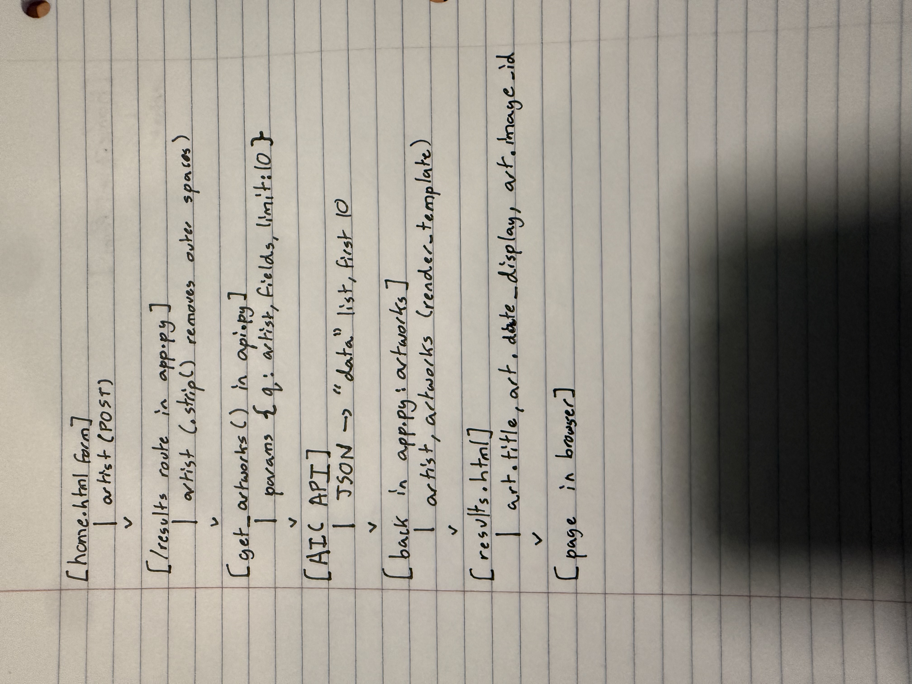

# HW5 findings

## 1. Drawing: one search for "Monet"

## 2. Two questions about the code
1. what does  do in results.html
2  What does request.values do in app.py? 

## 3. Checks (4 or more, at least 2 as pytest tests)
| # | Check | Pass or fail |
|---|---|---|
| 1 | pytest: empty search → "No search term entered." | Pass |
| 2 | pytest: search Monet → page says "Results for" | Pass |
| 3 | After searching, URL shows ?artist=Monet so it can be bookmarked | Fail: URL is just /results (form uses POST) |
| 4 | Each result shows the artist's name | Fail: artist_title is fetched but never shown |
| 5 | Search a made-up word (zxqwv) → see "No results found." | Fail: shows 10 unrelated artworks |
| 6 | Each result shows the artwork's image | Fail: broken image icon, only alt text shows |

## 4. AI review
What it found that I missed: The biggest one was debug=True on line 26 of app.py. I didn’t know that if someone hits an error page they can run code on your computer. It also caught that the error message prints {e} straight to the user, which shows internal stuff they shouldn’t see. Other things I missed: except Exception catches everything, so it could hide actual bugs; there’s no limit on how long the search can be; the error pages still send back a 200; and the error message isn’t set up for screen readers.
What it got wrong: It said the broken images were probably from image_id being None, but results.html already checks for that, and my results had an image_id and were still broken, so that’s not the reason. It also told me to add a “no results” message, but the template already has one. The actual problem is that a fake word like “zxqwv” still returns 10 random artworks, so that message never shows. It said alt text was missing, but the template already uses the title as alt. It also didn’t notice that artist_title gets requested but never shows up on the page, and it called [:10] a bug when it’s really just extra.
Answers to my two questions, in my own words:
1. It loops through every artwork in the list and gives the html for each one
2. it takes whatever the user inputted either as a GET or a POST.

## 5. My fix
What was wrong: The search form used POST, so after searching the URL was just /results. You couldn't bookmark, share or refresh a search (my check 3 failed).
What I changed: In home.html I changed method="post" to method="get", and in app.py line 13 I changed methods=["GET", "POST"] to methods=["GET"].
How I checked it works: I ran git diff to see only those 2 lines changed, then ran the app and searched Monet. The URL now shows /results?artist=Monet. I also reran python3 -m pytest and all 3 tests still pass.
Commit before: 01a8114  Commit after: af93bec

## 6. Can we ship it? (100–150 words)
Yes or no, and why: No.Honestly, I don’t think it’s ready yet. The tests pass and search does bring up art, but the big problem is that debug=True is still on, so anyone who hits an error page could run code on our server. The search is also misleading: a made-up word like “zxqwv” still shows 10 random artworks, and “/results” matched titles with “Result” because it searches all text, not just artists. On top of that, the images are broken and the artist’s name never shows up. None of it is hard to fix, but I’d want one more day to fix and retest before shipping.

One thing my HW4 does better:  My HW4 uses GET, so searches show up in the URL and can be bookmarked, while the AI’s app used POST
One thing the AI's app does better:  It has fallbacks like “Date unknown” and “No image available,” so missing data doesn’t break the page.

AI use goes in `ai_use.md` (the five points on the AI Use Card).
